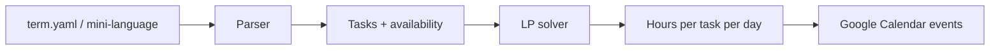

<div align="center">

# 🧭 Simplan

**An LP-based term planner that decides what to study when, then puts it on your Google Calendar.**


</div>

---

## Why this exists

Every term I rebuilt my calendar by hand: assignment deadlines, weekly quizzes, exam dates, and then guessed how to spread my time across them. Pivot automates both halves.

1. **Describe your term in a few lines.** Recurring deadlines, exceptions, exams.
2. **Pivot solves for your week.** A linear program allocates your available hours across tasks, weighted by the priorities you set.
3. **The plan lands in Google Calendar.** No clicking through the app.

I built it because I wanted to use it. If something similar already exists, that's fine.

---

## How it works



The solver is a pure function from tasks and availability to a plan, with no Google code inside it. That keeps it testable and easy to wrap in a service later.

---

## Feature 1: Calendar automation

Write deadlines in a short, readable syntax:

```text
assignment "CO 250 A3" every mon 23:59 from 2027-01-11 to 2027-04-05 except 2027-02-15 2027-03-01
quiz "MATH 235 Quiz" every fri 10:30 from 2027-01-15 to 2027-03-26
exam "CS 245 Midterm" on 2027-02-28 14:00 priority 5
```

Pivot translates each line into a Google Calendar recurring event using native `RRULE` strings, with `EXDATE`s for the exceptions. OAuth requests only the calendar-events scope.

---

## Feature 2: The optimizer

Let $x_{t,k}$ be the hours spent on task $k$ on day $t$, $w_k$ the priority weight, $r_k$ the hours the task needs, $d_k$ its deadline, and $H_t$ the hours available on day $t$. A shortfall variable $s_k$ keeps the model feasible when you are overloaded:

$$
\min \sum_k w_k \, s_k
$$

subject to

$$
\sum_{t \le d_k} x_{t,k} + s_k \ge r_k \quad \forall k
$$

$$
\sum_k x_{t,k} \le H_t \quad \forall t
$$

$$
x_{t,k},\ s_k \ge 0
$$

In words: spread the work so that the **weighted amount of unfinished work is as small as possible**. Your class schedule just becomes the $H_t$ values.

| Symbol | Meaning |
|---|---|
| $x_{t,k}$ | hours on task $k$ on day $t$ (decision variable) |
| $s_k$ | hours of task $k$ left undone (shortfall) |
| $w_k$ | priority weight you assign |
| $r_k$ | estimated hours required |
| $d_k$ | deadline (as a day index) |
| $H_t$ | hours available on day $t$ |

---

## Quick start

> Commands below describe the intended interface and will be filled in as each piece is built.

```bash
git clone https://github.com/nagariyaarchit/simplan.git
cd simplan
python -m venv .venv && source .venv/bin/activate
pip install -r requirements.txt

simplan auth                  # one-time Google OAuth
simplan parse term.yaml       # validate your term file
simplan solve term.yaml       # print the day-by-day plan
simplan push term.yaml        # write events to Google Calendar
```

---

## Project structure

```text
simplan/
├── simplan/
│   ├── parser.py      # mini-language -> task objects
│   ├── solver.py      # tasks + availability -> hours per day per task
│   ├── gcal.py        # OAuth + create/update events
│   └── cli.py         # typer-based command line
├── tests/
├── term.example.yaml
└── README.md
```

---

## Tech stack

| Area | Tools |
|---|---|
| Language | Python |
| Optimization | PuLP, HiGHS (via `scipy.optimize`) |
| Calendar | `google-api-python-client`, `google-auth-oauthlib`, `python-dateutil` |
| Input and CLI | PyYAML / pydantic, typer |
| Testing | pytest |

---

## Roadmap

- [ ] Google OAuth and creating a single recurring event
- [ ] Mini-language parser with `RRULE` and `EXDATE` generation
- [ ] LP model on a toy dataset (3 tasks, 7 days)
- [ ] Connect solver output to Calendar event creation
- [ ] `replan` command to re-solve mid-week when reality diverges
- [ ] Constraints: max hours per task per day, minimum block length
- [ ] Hand-written simplex (standard equality form) cross-checked against HiGHS
- [ ] Optional: deploy the solver as an AWS Lambda behind API Gateway, with CDK or Terraform

---

## Design notes and limitations

- LP produces **fractional hours**. Rounding to blocks (for example 30 minutes) is a planned refinement.
- Plans are only as good as the time estimates $r_k$. That is why re-planning is a first-class feature.
- Credentials and tokens stay local and are git-ignored.

---

## Author

**Archit Nagariya** · Mathematics (Honours Co-op), University of Waterloo
[GitHub](https://github.com/nagariyaarchit)
